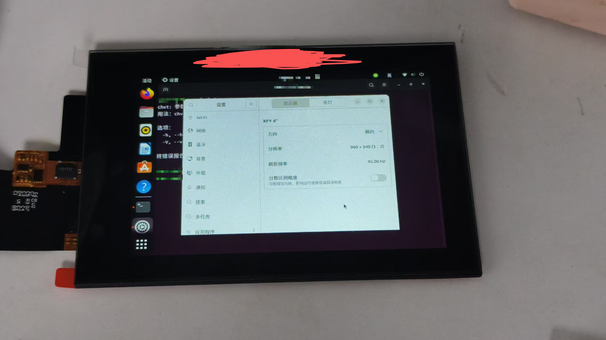
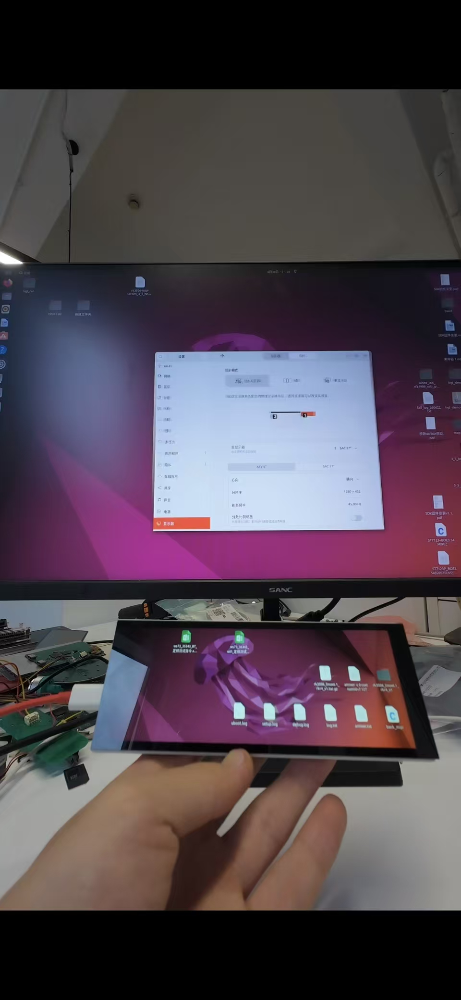

# USB DRM udisp driver
A Linux DRM graphics driver for ESP32-P4 USB display devices

Linux USB DRM/KMS 显示驱动，面向 `303a:2986` ESP 外接屏设备。  
Linux USB DRM/KMS display driver for `303a:2986` ESP-based external screens.

## 项目简介 / Overview

主要功能如下：  
Key capabilities:

- 支持标准 DRM/KMS 图形显示。  
  Standard DRM/KMS GUI display support.
- 支持 DRM fbdev emulation，可用于 TTY/fbcon。  
  DRM fbdev emulation for TTY/fbcon.
- 通过 USB vendor interface 传输显示数据。  
  Display transport over the USB vendor interface.
- 支持主机侧旋转，适配竖屏设备。  
  Host-side rotation for portrait-oriented devices.

## 硬件与嵌入式固件 / Hardware and Firmware

配套硬件设计与嵌入式固件工程请见：  
Hardware design and embedded firmware project:

[https://oshwhub.com/an_ye/project_ygsitoma](https://oshwhub.com/an_ye/project_ygsitoma)

## 使用效果 / Usage Preview


### 960x640



### 452x1280




## 编译 / Build

```sh
make
```

## 加载驱动 / Load

```sh
sudo insmod udisp_drm.ko
```

默认情况下，驱动向主机暴露横屏分辨率。例如，对于原生竖屏 `452x1280` 面板，主机侧可看到 `1280x452`，随后驱动会在发送 JPEG 数据前旋转回设备原生方向。  
By default, the driver exposes a landscape mode to the host. For example, a native `452x1280` portrait panel is exposed as `1280x452`, and frames are rotated back before JPEG transfer.

如果需要显式启用主机横屏模式：  
For explicit host-side landscape mode:

```sh
sudo insmod udisp_drm.ko host_native=0 rotate=90
```

`host_native=0 rotate=90` 表示主机帧缓冲为横屏，发送前顺时针旋转到设备的原生竖屏方向。  
`host_native=0 rotate=90` means the host framebuffer is landscape and is rotated clockwise into the device-native portrait geometry before transfer.

如果需要输出更详细的发送日志：  
For verbose send diagnostics:

```sh
sudo insmod udisp_drm.ko debug=1
```


## 安装与开机自动加载 / Install and Autoload

对于 GNOME/Mutter 测试，建议在图形会话启动前完成模块自动加载，避免热插拔状态被缓存。  
For GNOME/Mutter testing, it is better to autoload the module before the graphical session caches hotplug state.

```sh
sudo make install
sudo tee /etc/modprobe.d/udisp_drm.conf >/dev/null <<'EOF'
options udisp_drm debug=1 connector_type=usb host_native=0 rotate=90 keepalive_ms=10000
EOF
sudo reboot
```

重启后，USB modalias 会自动为 interface 0 加载 `udisp_drm`。建议避免在 GNOME 运行期间频繁执行 `unbind`、`rmmod`、`insmod`，否则 Mutter 可能在下次重新登录前保留过期的 secondary-GPU CRTC 状态。  
After reboot, the USB modalias should autoload `udisp_drm` for interface 0. Avoid repeated `unbind` / `rmmod` / `insmod` cycles while GNOME is running, because Mutter may keep stale secondary-GPU CRTC state until the next login session.

## 旋转与性能诊断 / Rotation and Performance Diagnostics

启用 `debug=1` 后，驱动会周期性打印帧缓冲与耗时信息。  
With `debug=1`, the driver periodically logs framebuffer metadata and timing.

```text
frame stats: fb=1280x452 pitch=5120 cpp=4 fmt=XR24 out=464x1280 auto_rotate=90 keepalive=0 ring=3 convert=2ms encode=8ms usb=10ms total=14ms fps=...
```

- `ring=3` 表示驱动使用了 3 个预分配的 JPEG 传输槽位。  
  `ring=3` means the driver is using three preallocated JPEG transfer slots.
- 在负载下，整体吞吐更接近 `max(encode, usb)`，而不是 `encode + usb`，因为图像生产与 USB 发送分别运行在独立的有序工作队列中。  
  Under load, throughput is closer to `max(encode, usb)` than `encode + usb` because the producer and USB sender run on separate ordered workqueues.
- 如果日志出现 `frame ring full`，说明 USB 侧已经饱和，驱动会主动丢弃旧帧，以避免累积延迟。  
  If the log reports `frame ring full`, the USB side is saturated and the driver intentionally drops old frames instead of building latency.

对于默认横屏模式 `host_native=0 rotate=90`，`convert` 通常应保持在较低毫秒级。若看到约 `150ms`，通常表示旋转快速路径未生效。Keepalive 帧一般会显示 `convert=0ms encode=0ms`，因为它会复用上一帧的 JPEG 数据。  
For the default landscape mode `host_native=0 rotate=90`, `convert` should stay in the low millisecond range. A value around `150ms` usually means the rotation fast path is not active. Keepalive frames should normally show `convert=0ms encode=0ms` because they reuse the last JPEG payload.

当合成器提交类似 `1280x452` 的横屏帧缓冲，并且配置了 `rotate=90` 或 `rotate=270` 时，驱动会自动旋转回设备原生的 `452x1280` JPEG 帧，避免把交换后的尺寸误当作竖屏原生布局读取，从而减少对角撕裂问题。  
If the compositor submits a landscape framebuffer such as `1280x452`, the driver auto-rotates it back into the device-native `452x1280` JPEG frame when `rotate=90` or `rotate=270` is configured. This avoids diagonal tearing caused by reading a swapped-size framebuffer as if it were native portrait.

## 调试选项 / Debug Options

测试时如果想用画质换取更高 FPS，可以覆盖设备上报的 `Ejpg` 值。  
To trade quality for FPS during testing, override the device-reported `Ejpg` value.

```sh
sudo tee /etc/modprobe.d/udisp_drm.conf >/dev/null <<'EOF'
options udisp_drm debug=1 connector_type=usb host_native=0 rotate=90 jpeg_quality=3 keepalive_ms=10000
EOF
sudo reboot
```

如果不设置 `jpeg_quality`，则默认使用设备描述符中的值，当前为 `Ejpg6`。  
Leave `jpeg_quality` unset to use the device descriptor value, currently `Ejpg6`.

如果想把显示/JPEG 解码问题与 GUI 帧缓冲读取问题分开排查，可以启用内部测试图案。  
To isolate display/JPEG decode issues from GUI framebuffer reads, enable the internal pattern generator.

```sh
sudo tee /etc/modprobe.d/udisp_drm.conf >/dev/null <<'EOF'
options udisp_drm debug=1 connector_type=usb host_native=0 rotate=90 test_pattern=1 keepalive_ms=10000
EOF
sudo reboot
```